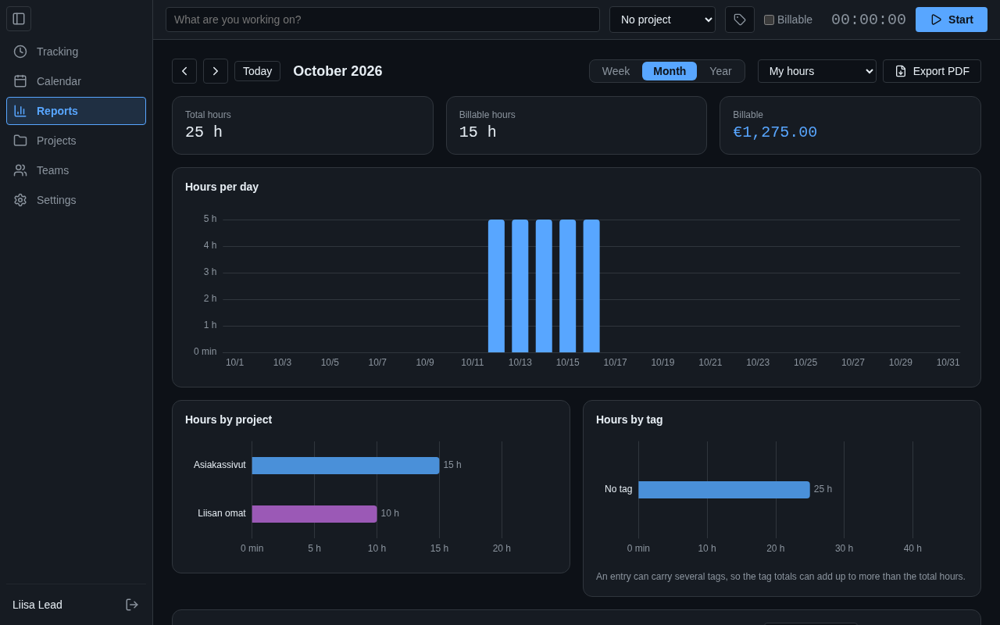

# HexTime

Time tracking for one person on their own computer, or for a whole organisation on its own server. One codebase, two ways to run it.



- **Timer and entries**: start and stop a timer, or enter time by hand; edit it afterwards.
- **Projects, tasks and tags**, with billable hours and hourly rates.
- **Day, week, month and year views**, and reports with charts.
- **PDF reports** for a period, a project or a team.
- **Finnish and English**, a dark theme by default and a light one.

## Two ways to run it

**On your own computer** (Linux; Windows later). A desktop window, no account, no server. Your data stays in a SQLite file in your user directory and nothing is sent anywhere.

**On an organisation's server.** A web app with sign-in limited to the organisation's email domain. The administrator adds people; anyone can create a team and invite colleagues. A team shares its projects and sees each member's total hours on them, never anyone's single entries. Runs as rootless Podman containers (HexTime, PostgreSQL, Caddy with HTTPS), installed with one script that asks a few questions: see [docs/docs/Install-server.md](docs/docs/Install-server.md).

## Installing the desktop app

There are no published packages yet. Build the app, then install it for your user:

```bash
./packaging/build-app.sh            # needs Node, uv, and the system's GTK and WebKitGTK
./packaging/linux/install.sh        # into ~/.local, with a menu entry
```

On Debian and Ubuntu, `./packaging/linux/build-deb.sh` makes a `.deb` package of the same build instead ([docs/docs/Run.md](docs/docs/Run.md) has the details).

## Development

The backend is Python (FastAPI, SQLAlchemy, Alembic) and the frontend Svelte 5. [docs/docs/Run.md](docs/docs/Run.md) shows how to run it in development, in server mode with demo users (`./scripts/dev-server.sh`), and as the full container stack.

```bash
cd backend && uv run pytest              # backend tests
cd frontend && npm test && npm run check # frontend tests and types
```

The guides and an overview of the architecture form a small documentation site: `cd docs && uvx --with mkdocs-material --with mkdocs-awesome-nav mkdocs serve`.

How the code is put together is in [docs/docs/architecture.md](docs/docs/architecture.md).

## License

[MIT](LICENSE)
